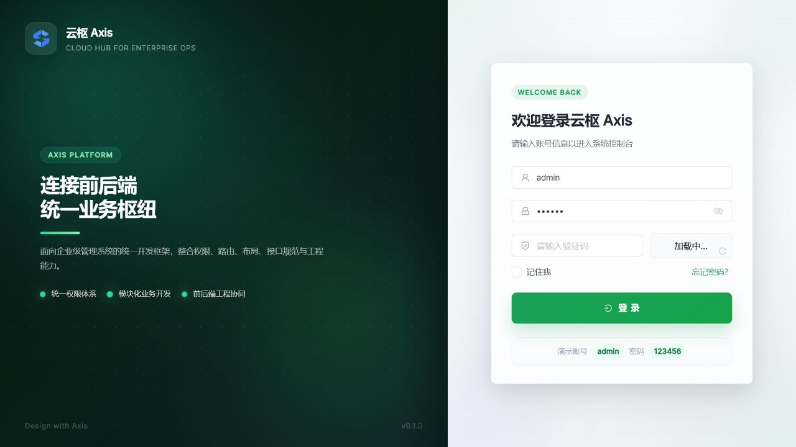
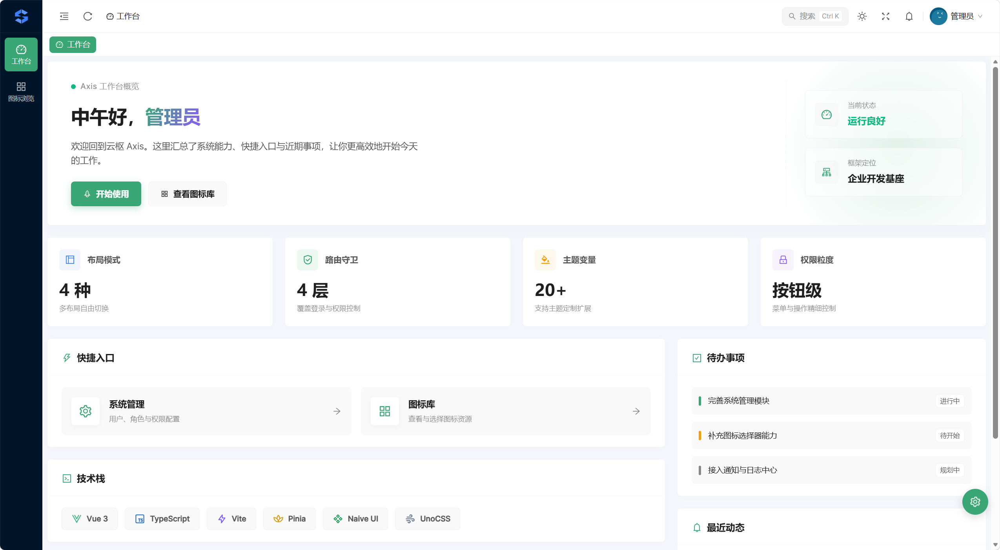

<div align="center">

# 云枢 Axis

面向企业级中后台的 Vue 3 前端开发基座

[](./package.json)
[](https://vuejs.org/)
[](https://www.typescriptlang.org/)
[](https://vite.dev/)
[](./LICENSE)

[Gitee 仓库](https://gitee.com/syb001/axis-admin-vue)

</div>

## 项目定位

云枢 Axis 提供中后台项目常用的路由、权限、布局、主题、请求与表格能力，适合作为管理后台、运营平台和企业内部系统的前端基座。当前版本为 `0.1.0`，重点是工程骨架和通用能力，具体业务接口仍需按实际后端接入。

## 已有能力

- Vue Router 静态/动态路由、登录守卫、Catch-all 与 403/404 页面
- 菜单、页面、按钮三级权限控制与标签页导航
- Axios 请求封装、Token 刷新队列、统一错误处理、请求节流与防抖
- 多布局、明暗主题、主题色和圆角配置
- AxisTable：远程/本地数据、分页、紧凑搜索、列设置、选择、行操作与 CSV 导出
- Iconify 图标、本地图标、图标选择器
- Vite 分包、压缩与可选产物分析

AxisTable 的配置方式与搜索示例见 [组件说明](./src/shared/components/axis-table/README.md)。

## 页面预览

仓库当前维护两张与现有页面对应的截图，不再引用尚未生成的占位图片。

### 登录页



### 工作台



## 技术栈

- Vue 3.5、TypeScript 6、Vite 8
- Vue Router 5、Pinia 3
- Naive UI、UnoCSS、SCSS
- Axios、VueUse、Iconify、dayjs
- pnpm 10

## 环境要求

项目固定使用：

- Node.js `26.4.0`（见 `.nvmrc`、`.node-version` 与 `package.json#engines`）
- pnpm `10.28.2`（见 `package.json#packageManager`）

Node 版本管理器可使用 nvm、fnm、Volta 或其他等价工具。安装并激活 Node 后，建议通过 Corepack 准备项目指定的 pnpm：

```bash
corepack enable
corepack prepare pnpm@10.28.2 --activate
node --version
pnpm --version
```

## 快速开始

```bash
pnpm install --frozen-lockfile
pnpm dev
```

开发服务端口、代理地址和 API 前缀由 `.env`、`.env.development` 与 `.env.production` 控制。登录、验证码和系统管理页面依赖对应后端接口；未启动后端时，可先查看项目结构和本地表格示例代码。

## 常用命令

| 命令 | 用途 |
| --- | --- |
| `pnpm dev` | 启动开发服务器 |
| `pnpm type-check` | 执行 Vue/TypeScript 类型检查 |
| `pnpm build` | 类型检查后构建生产产物 |
| `pnpm build-only` | 仅执行 Vite 构建 |
| `pnpm preview` | 本地预览生产产物 |
| `pnpm format` | 使用 Prettier 格式化 `src` |

## 目录结构

```text
axis-admin-vue/
├─ build/vite/                # Vite 配置拆分
├─ docs/images/               # README 实际截图
├─ public/                    # 公共静态资源
├─ src/
│  ├─ assets/                 # 图片、图标、字体和主题样式
│  ├─ config/                 # 应用配置
│  ├─ layouts/                # 布局与主题消费逻辑
│  ├─ modules/                # 业务域：api / permissions / views
│  ├─ pages/                  # 仅壳页面：login、exception
│  ├─ router/                 # 路由、守卫与动态路由
│  ├─ shared/                 # 通用组件、HTTP、权限判断和工具（含 utils/dayjs）
│  └─ store/                  # 全局壳状态（登录、主题、标签等）
├─ .nvmrc                     # Node 固定版本
├─ .node-version              # 通用 Node 版本文件
├─ package.json
├─ pnpm-lock.yaml
└─ vite.config.ts
```

## 字体与构建产物

英文使用 Inter；中文仅打包 Noto Sans SC 简体中文的 `400` 和 `700` 两个 WOFF2 文件，其他字重由浏览器合成。这样既保留跨平台的中文显示一致性，也避免 `@fontsource` 全量 CSS 把数百个字形切片复制进 `dist`。

设置 `VITE_ANALYZE=true` 后执行构建，可生成包体分析报告：

```bash
VITE_ANALYZE=true pnpm build-only
```

PowerShell 可使用：

```powershell
$env:VITE_ANALYZE='true'; pnpm build-only
```

## 开发约定

- 业务在 `src/modules/<域>/views`，壳页在 `src/pages`；页面只负责编排，复杂流程进 `composables/`
- 通用工具进 `src/shared/utils`（时间用 dayjs），模块 `utils/` 仅放独有逻辑
- 业务接口放入 `src/modules/<域>/api`；弹窗/抽屉用 `FormDialog` / `DetailDrawer`
- 新增请求时明确是否需要 `debounce`、`throttle` 及稳定的请求 `key`
- 修改路由后同时验证未登录、已登录、无权限和未知地址四种场景
- 提交前至少执行 `pnpm type-check` 与 `pnpm build-only`

## 版本说明

### 0.1.0

- 完成基础布局、权限、路由、请求和 AxisTable 能力
- 修正 Token 刷新并发队列、请求节流/防抖与 Catch-all 注册
- 固定 Node/pnpm 工具链版本
- 拆分 AxisTable、登录页与首页的大文件
- 精简中文字体构建产物，并同步项目文档、截图引用和 License

## License

本项目基于 [MIT License](./LICENSE) 开源。
